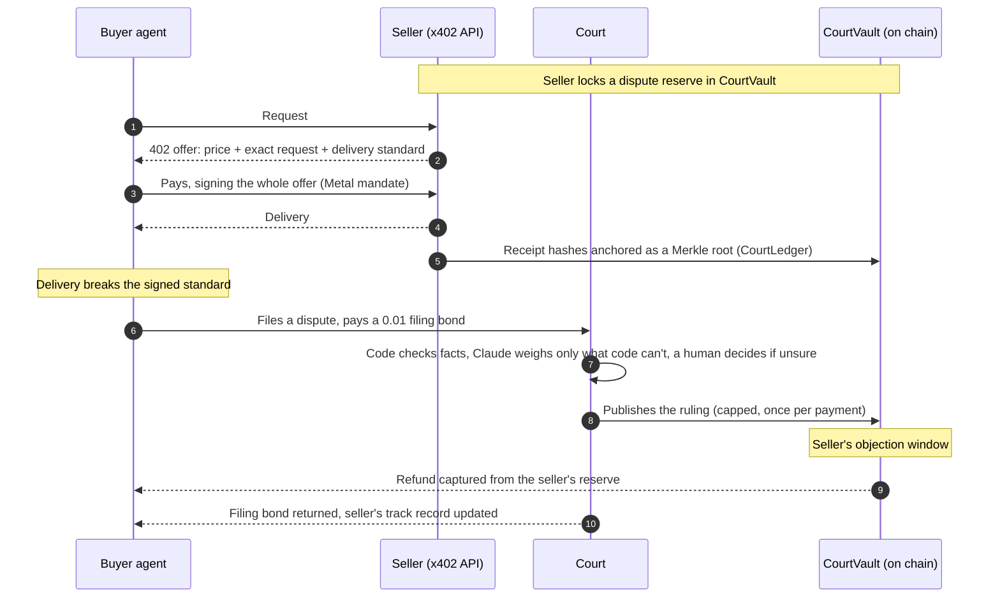
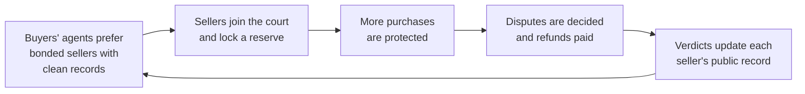
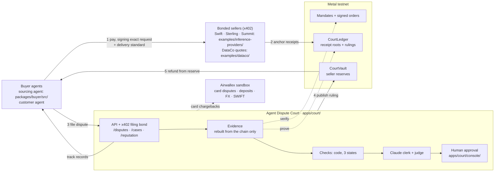

# Agent Dispute Court

**Buyer protection for agent payments.** When an AI agent pays another agent over x402 and gets something broken back, it can get its money back.

Agent Dispute Court lets a buying agent sign exactly what it is paying for. Sellers back their promises with a reserve locked on chain. When a promise is broken, the court decides the case and refunds the buyer from that reserve automatically. Every verdict feeds a public track record that agents use to choose who to buy from.

It does not hold buyers' funds, and it cannot spend a seller's reserve except through a published, capped ruling that the seller had time to object to. Everything below ran live on **Metal testnet** and the **Airwallex sandbox**.

> Airwallex Agentic Banking Hackathon. Primary track: **x402 Business Agents** (Kit 11). The live buyer is an **Inference Sourcing Agent** (Kit 12), and the card side applies **Dispute Response** (Kit 4). Built on Metal and Airwallex, with Claude.

---

## The problem

Card payments are trusted because the buyer can dispute them. Fifty years of reason codes, evidence rules and chargebacks sit behind every card swipe.

Agent payments have none of that. An x402 payment settles in stablecoin in seconds, and there is no issuer to call. If a data API returns a stale price, or an inference provider returns a broken result, the buying agent has paid, and that is the end of it. The x402 Foundation is still debating how disputes should work ([#3500](https://github.com/x402-foundation/x402/issues/3500), [#3678](https://github.com/x402-foundation/x402/issues/3678), [#3945](https://github.com/x402-foundation/x402/issues/3945)). One gap is called out in those threads and left open: even when a seller is found liable, **nothing makes it pay**.

Agents will not be trusted with real budgets until they can get money back.

## How it works: promise, judge, recover



**1. Promise.** The seller's x402 offer names the exact request (`GET /infer?task=summary-v1&text=…`) and a delivery standard, for example *"a JSON summary, at most 400 characters, echoing this request's hash"*. The buyer's agent signs the whole offer. Metal's docs say a signed order covers "the route, the price, the payee and the network, not the request's parameters". We found that the agent signs the *entire* offer, and verified on chain that this binds it to the exact query and the quality bar. Every delivery receipt is anchored in a Merkle root on chain, so the seller cannot rewrite it later.

**2. Judge.** The court rebuilds each sale **only from what it can verify**: the signed order (checked against the chain), the on-chain payment, and the receipt's Merkle proof. Then:
- **Code decides facts.** Signatures, duplicates, amounts, payees, and whether the delivered body meets the signed standard.
- **Claude** turns plain-English complaints into structured claims, and weighs data quality only when code could not check it. It can never overturn a code finding.
- **A human** decides when Claude's confidence is below 0.8. The approval must restate the exact refund amount, or it is refused.

Every claim ends in one of three states: `DIFFERENCE_CONFIRMED`, `NO_DIFFERENCE_FOUND`, or `COULD_NOT_BE_CHECKED` with a reason. An unchecked claim is escalated, never silently rejected.

**3. Recover and remember.** The ruling is published to `CourtVault`. After the seller's objection window, anyone can execute it, and the refund is captured from the seller's reserve straight to the buyer. The verdict is added to the seller's public record at `GET /reputation`.

## Why it compounds



A guarantee is only worth something if buyers act on it. So the court publishes each seller's record, and our buying agent prices it in: **effective price = price × (1 + 2 × loss rate)**. A seller that loses every dispute costs three times its sticker price. Good sellers win business, bad ones lose it, and bonding becomes the cost of being chosen.

---

## See it work: two cases

### Case 1, the automatic one: a buying agent sues by itself

A sourcing agent must summarise six business documents. Three Claude-backed providers sell summaries over x402, each with 0.5 *USDZ locked as a dispute reserve:

| Provider | Model | Price |
|---|---|---|
| Swift | Claude Haiku | 0.02 *USDZ |
| Sterling | Claude Sonnet | 0.03 *USDZ |
| Summit | Claude Opus | 0.06 *USDZ |

The agent pays under its own Metal mandate: at most 0.06 per payment and 3 in total, and only to these three providers and the court. Before each step it probes the market and picks the cheapest provider that is under the cap, fast enough, and has a good record.

| Step | What happened | Tx |
|---|---|---|
| Docs 1–2 | Swift is cheapest and wins | [`0x8936dd…34f7`](https://testnet.metalntwx.com/tx/0x8936dd8aef40b225fc5194e07b0c7f285de19e949d335a2e70cf66ad24eb34f7), [`0x18d4ec…4bd1`](https://testnet.metalntwx.com/tx/0x18d4ecd2c4e9bcdefb258eaa4cccfb1ca975217964fd339eda454c4fc3084bd1) |
| Doc 3 | Swift's price jumps to 0.07, over the cap, so the agent reroutes to Sterling | [`0x6b8e08…e802`](https://testnet.metalntwx.com/tx/0x6b8e088697266b170a3f71f88691502e63f1d55f73bb04939df0e5d8c7f2e802) |
| Doc 4 | Sterling is paid but delivers a truncated body. The agent checks it against the signed standard and rejects it (`body_unparseable`) | [`0x6bf4a2…9b33`](https://testnet.metalntwx.com/tx/0x6bf4a2d2f8448bb1550e0fe8ef0a6915cfc8d0c10c9a859ec061f46923389b33) |
| Doc 4 | Re-bought from Summit and accepted | [`0xf16102…4f99`](https://testnet.metalntwx.com/tx/0xf16102e4cb0207bfffa31f749aacebe1479ca51985924b4d43b3acdf9f4c4f99) |
| Doc 5 | Summit takes 5 s to answer and is skipped as slow; Sterling delivers | [`0xcc1bbd…8f73`](https://testnet.metalntwx.com/tx/0xcc1bbda315f1f3a7cc7400a874b87a7e1e9f82dbb0a7d6499500c1c3e2458f73) |
| Evidence | Sterling's receipts anchored as one Merkle root | [`0x2149a2…1943`](https://testnet.metalntwx.com/tx/0x2149a29bd795a6a956e9b8c9b1f411b542cdbcce0a8128479f23128b8df61943) |
| **Dispute** | **The agent files against Sterling by itself**, with a complaint it writes deterministically, and pays the filing bond | [`0x901f87…96f3`](https://testnet.metalntwx.com/tx/0x901f8771d47d4c1299c90e9ad5559c3553ae736e795aa13bbcec3cc17b6896f3) |
| Ruling | `A13.3`, decided by code with no model needed: REFUND 0.03, published on chain | [`0x264d05…f964`](https://testnet.metalntwx.com/tx/0x264d05bf267ce55e7a91bba03b3362c4fa5651563870435f0e9680681fa8f964) |
| Refund | After the objection window: 0.03 captured from Sterling's reserve, filing bond returned | executed on chain |
| Doc 6 | Sterling's record (1 loss in 1 claim) puts its effective price at 0.03 × 3 = 0.09, worse than Summit's 0.06. Swift is back at 0.02 and wins | [`0x4fb4a9…ad63`](https://testnet.metalntwx.com/tx/0x4fb4a94a8d3e4edb4b673a3b34d5314deab456f35ac013c8feda2bdf9c52ad63) |

**Result:** 6 of 6 documents done, 0.21 *USDZ spent, 0.03 recovered, no human involved. The broken delivery cost the agent nothing, and it cost Sterling future business.

The provider, the agent and the court all check deliveries with **the same pure function** ([`packages/protocol/src/infer.ts`](packages/protocol/src/infer.ts)), so they cannot disagree about what was promised.

### Case 2, the hard one: a messy complaint

A customer's agent bought six market quotes from DataCo. DataCo served a stale TSLA quote and an MSFT price 3% off, and charged AAPL twice. The owner complained in plain English:

> *"My agent never asked for NVDA, it wanted AMD. I was charged twice for AAPL. The TSLA quote was stale and the MSFT price was wrong. The GOOG price also looked wrong, but I can't tell you by how much."*

Claude split this into six claims, and treated it as untrusted input. Then:

| Claim | Finding | Verdict | Decided by | Purchase | Ruling | Refund |
|---|---|---|---|---|---|---|
| NVDA "never ordered" (`A10`) | The agent's own signature names `?symbol=NVDA` | REJECT: the customer's agent is liable | code | [`0xa52cc0…5d5c`](https://testnet.metalntwx.com/tx/0xa52cc0c6eb0b89234432eb05c0253589967a43ebec8b08fea583b09969ea5d5c) | n/a | n/a |
| AAPL first charge (`A12`) | Not a duplicate | REJECT | code | [`0xf6bd28…786c`](https://testnet.metalntwx.com/tx/0xf6bd28967c5c1da733ecfed8c05d6a0c97c1cc577920ef3c3c643859c32d786c) | n/a | n/a |
| AAPL second charge (`A12`) | Duplicate of the first, from chain history | REFUND | code | [`0xbb8f3e…5531`](https://testnet.metalntwx.com/tx/0xbb8f3e5134b9aa88c292ff4099b4de253d6da37c15ae503d1c19d0df9c055531) | [`0xdbc74b…46a5`](https://testnet.metalntwx.com/tx/0xdbc74b31cd6a20db19411db50a4cabbcd321801a45d670507baa0fe3ba7b46a5) | [`0xdaf1eb…0b9d`](https://testnet.metalntwx.com/tx/0xdaf1eb85bab476b5ad1077cdfbb78be849302fbf651b91e47c8818cd354d0b9d) |
| TSLA stale (`A13.3`) | Breaks the signed 60 s freshness limit | REFUND | code | [`0xa34242…a062`](https://testnet.metalntwx.com/tx/0xa34242aea91183f461cf40a109734818abf69f4e7e9753dac65d0e2602eba062) | [`0x8c7140…d0ac`](https://testnet.metalntwx.com/tx/0x8c7140b54dfb6ff33ffdaf9f02b2a2e15df66a6dda4a5f3e6f65356c1a3ed0ac) | [`0xfd0895…b215`](https://testnet.metalntwx.com/tx/0xfd08953d89d1d49e477cc4d3d90305e60214e200e848437dfb4a195ab317b215) |
| MSFT wrong (`A13.3`) | About 300 bps off, above the signed 50 bps limit | REFUND | code | [`0x05ba53…c2e2`](https://testnet.metalntwx.com/tx/0x05ba5309dd60e993506c3ebd94309a17e5340366f008da3062b15e0a4a35c2e2) | [`0xe6b37b…ad20`](https://testnet.metalntwx.com/tx/0xe6b37b768632326a59492120bc3a468b6a1af420b2bb7c53f83b1dee911aad20) | [`0xfc3a3a…f723`](https://testnet.metalntwx.com/tx/0xfc3a3ab8019ce082a3fdf130f59f3b579e84c158133ca0cd254378044a90f723) |
| GOOG "looked wrong" (`A13.3`) | Could not be checked (no independent GOOG price feed). Claude was not confident and escalated | REFUND, approved by a human, bound to exactly 0.05 | human | [`0xabe615…73ce`](https://testnet.metalntwx.com/tx/0xabe615bef30e1f513deade7fb4b44702dad0d4e4297bc9590e98613163c073ce) | [`0xfc425a…5d71`](https://testnet.metalntwx.com/tx/0xfc425a6a28669fbb0c2f56b5e59812e77ad79aac9ac265e800fcae4936bf5d71) | [`0x7324ea…492d`](https://testnet.metalntwx.com/tx/0x7324eaf52f00f2f9dad142471b8ca5941a7e6b44fdb7463345eb5c014533492d) |

| Step | Transaction |
|---|---|
| Six receipts anchored (`CourtLedger` batch 3) | [`0xdc4c28…80d8`](https://testnet.metalntwx.com/tx/0xdc4c2851274a221de5e5008b9ffbadcb62ccefef8f2e5835b86f07d14fe880d8) |
| Dispute filed, filing bond paid over x402 | [`0xa761bf…30d3`](https://testnet.metalntwx.com/tx/0xa761bf21dd1491dcb6a75ceaa0883d99262292204402b0244208a1c00a9330d3) |
| Filing bond refunded (the customer won some claims) | [`0xff2236…18f5`](https://testnet.metalntwx.com/tx/0xff2236d115f17fdbb940bc9cde4e9c5f199d7561ea97d579946e86ecf6ed18f5) |

Two things this case shows. The court protects sellers too: "my agent never ordered that" lost, because the agent's own signature says otherwise. And when the facts can't be checked, a person decides; the court doesn't guess.

Operators follow every case in the console (`/console/`). It shows each claim's finding and verdict, who decided it (code, model or human), and explorer links for every transaction.

---

## Why you can trust the court

The court is only useful if sellers can trust it with their reserve.

- **Its power over reserves is narrow.** `CourtVault` releases money only through a published ruling: at most `maxRefund`, once per payment, and only after the objection window. During that window the seller can object, which blocks execution. The court only rules on payments whose on-chain payer is the filer, and the filer is whoever paid the filing bond, so a refund can only go back to the agent that paid. See [`packages/contracts/contracts/CourtVault.sol`](packages/contracts/contracts/CourtVault.sol).
- **Code owns facts.** The model never decides a signature, amount, duplicate or delivery-standard question, and its output is schema-validated.
- **No unchecked claim looks rejected.** There are three states, and the unchecked one carries its reason.
- **Approvals are bound to the amount shown.** A human approval must restate the exact refund amount, or it is refused (409).
- **Disputes cost something.** A 0.01 filing bond, refunded only if a claim wins, deters spam disputes.
- **Money moves at most once.**
  - Rulings: one per payment, enforced by the contract.
  - Mandate payouts: keyed by payment id.
  - Fee refunds: guarded by a per-case lock.
  - Treasury settlement: idempotent by tx hash.
- **Buyers opt in.** A buyer's mandate must list the court as a payee before it can file, so the court cannot charge anyone who did not choose it.

## Reason codes

| Code | Claim | Decided by | Card analogue |
|---|---|---|---|
| `A10` | "My agent never ordered this" | Mandate binding plus the signature over the exact request | Visa 10.4 |
| `A12` | "Charged twice" | The same signed request hash settled twice, from chain history | Visa 12.6.1 |
| `A13.1` | "Paid, got nothing" | No anchored receipt, or an error response | Visa 13.1 |
| `A13.3` | "Not as described" | The **signed delivery standard** re-run on the anchored body (`quote-v1`: freshness and accuracy; `infer-v1`: schema, length and request hash). Claude only for what code can't check | Visa 13.3 |
| `A14` | "Price or payee was off" | The signed offer against the seller's price list | n/a |

## How it maps to the x402 dispute proposals

| Proposal | What it asks for | Where it lives here |
|---|---|---|
| [#3500](https://github.com/x402-foundation/x402/issues/3500): dispute evidence | An evidence triple: authorization scope, the action, and a delta a resolver can check mechanically | **Scope** = the Metal mandate, bound on chain. **Action** = the settled payment plus the agent's signed order. **Delta** = computed by [`apps/court/src/checks.ts`](apps/court/src/checks.ts), never asserted by a party |
| [#3678](https://github.com/x402-foundation/x402/issues/3678): delivery conformance | Acceptance criteria in the offer; the receipt carries the delivered body's hash; a resolver re-runs a named verifier | `extra.acceptance` (`quote-v1` or `infer-v1`) is **signed by the buyer's agent**. Receipts store `responseHash`, anchored on `CourtLedger`. `A13.3` re-runs the verifier |
| [#3945](https://github.com/x402-foundation/x402/issues/3945): three states | `DIFFERENCE_CONFIRMED` / `NO_DIFFERENCE_FOUND` / `COULD_NOT_BE_CHECKED` | Exactly these, each with a reason |
| The recovery gap from #3500 | Remedies on a push rail | **What this project adds:** `CourtVault` plus MIP20 holds give enforced recovery from a seller's reserve |

---

## Beyond x402: the same protection for sellers' agents and for cards

**Sellers' own agents (Kit 11).** DataCo runs three agents from one Metal account, each under its own on-chain spending limit. When its upstream supplier raises the price from 0.02 to 0.04, above the sourcing agent's 0.03 cap, Metal refuses the purchase and nothing is paid. The treasury agent re-plans from the real on-chain spend and proposes new limits within the 20 *USDZ total. A human approves, and the mandate is replaced. Earnings then settle into Airwallex, with the on-chain tx hash as the deposit reference, and a EUR licence fee goes out by SWIFT.

| Step | Transaction / result |
|---|---|
| Sourcing agent buys upstream at 0.02 | [`0x582e9c…`](https://testnet.metalntwx.com/tx/0x582e9c405c3d64393f46a648518de1005f7f592bba484952eac6f5632996f59b), [`0xac8c8f…`](https://testnet.metalntwx.com/tx/0xac8c8f1606b923e18e699befd6ce2b867a797b5db9ea1e93490b9c7cbbf9a545) |
| Upstream rises to 0.04, so the next purchase is refused on chain | `mandate_cap_exceeded`, nothing paid |
| Re-plan, human approval, mandate replaced | cap 0.03 → 0.04, total held at 20.00 *USDZ |
| Treasury moves earnings to settlement | [`0xab4ab5…651e`](https://testnet.metalntwx.com/tx/0xab4ab554ee9036ade2157e6194e778ab55d82edd5d9ba560e16e4a032da6651e) |
| Earnings credited in Airwallex (deposit reference = that tx hash) | sandbox deposit |
| EUR 50 licence fee paid by SWIFT | sandbox transfer `a51d61b9-fb59-4f94-b17e-65c9eddd6bb0` |

**Card chargebacks (Kit 4).** The same decision rules handle ordinary card disputes through the Airwallex API. A dispute is challenged only when `p(win) × amount > dispute fee`.

| Case | Decision | Result |
|---|---|---|
| USD fraud claim (10.4): device match, 3 prior orders, signed delivery | **CHALLENGE** (p = 0.85) | Evidence PDF uploaded and challenged; the bank escalates to CHARGEBACK and the case is back in `REQUIRES_RESPONSE` |
| Small not-received claim (13.1): the fee exceeds the expected recovery | **ACCEPT** | `ACCEPTED` |
| Credit not processed (13.6): the customer wrote to support twice with no reply | **ESCALATE** | To a human, no API call |

---

## Architecture



## Where the sponsor technology is used (judges look here)

| Capability | Technology | Code |
|---|---|---|
| Buyers sign the exact request and the delivery standard | Metal signed orders and mandates | [`packages/seller/src/offer.ts`](packages/seller/src/offer.ts), [`apps/court/src/order.ts`](apps/court/src/order.ts) |
| Every claim rebuilt from the chain | Metal `verifyMandatePayment`, `CourtLedger` Merkle proofs | [`apps/court/src/evidence.ts`](apps/court/src/evidence.ts) |
| Seller reserves and enforced refunds | Metal MIP20 holds, `CourtVault` | [`packages/contracts/contracts/CourtVault.sol`](packages/contracts/contracts/CourtVault.sol), [`apps/court/src/remedy.ts`](apps/court/src/remedy.ts) |
| Filing bond and paid inference | x402 (`@x402/core`, `@x402/express`) on Metal | [`apps/court/src/api.ts`](apps/court/src/api.ts), [`examples/inference-providers/server.ts`](examples/inference-providers/server.ts) |
| Spending limits per agent; refusal on a price jump | Metal mandates, `metal-agent` | [`packages/buyer/src/cli.ts`](packages/buyer/src/cli.ts), [`examples/dataco/mandates.ts`](examples/dataco/mandates.ts) |
| Complaint intake, residual quality judgment | Claude structured outputs | [`apps/court/src/judge.ts`](apps/court/src/judge.ts) |
| Inference providers | Claude Haiku, Sonnet and Opus | [`examples/inference-providers/server.ts`](examples/inference-providers/server.ts) |
| Card chargebacks: challenge, accept, escalate | Airwallex payment disputes and files | [`apps/court/card/`](apps/court/card/) |
| Earnings settlement, FX, supplier payout | Airwallex deposits, conversions, beneficiaries, SWIFT | [`examples/dataco/treasury/`](examples/dataco/treasury/) |
| Routing by court reputation | `GET /reputation` | [`packages/buyer/src/router.ts`](packages/buyer/src/router.ts) |

---

## Try it

**Without credentials.** The test suite runs the whole decision logic offline: checks, verdicts, the router, the providers, the API and the card rules, with no network and no keys.

```bash
npm install
npm test        # 251 tests
```

**Live.** You need Node 26 or later (TypeScript runs natively, with no build step), a Metal testnet RPC endpoint, an Airwallex sandbox account in a payments-supported country, and an Anthropic API key. Keys and credentials are **never** stored in this repo; point the services at files and environment variables you keep elsewhere.

```bash
npm run compile   # packages/contracts/contracts → packages/contracts/contracts/build
```

1. **Sellers.**
   - Start DataCo:
     ```bash
     SELLER_PAY_TO=0x... METAL_RPC_URL=... PORT=4031 node examples/dataco/server.ts
     ```
   - Start the three inference providers. The launch lines are in the header of [`examples/inference-providers/server.ts`](examples/inference-providers/server.ts), on ports 4061–4063.
2. **Court.**
   ```bash
   METAL_RPC_URL=... COURT_KEY_FILE=/path/court.key.json \
   COURT_VAULT=0xe0e90b1bc4792aa26cb83c7f2e82c3a19b7e46d8 \
   COURT_LEDGER=0x2528db9267bd6bc9950ab74ad83d748b64e18042 COURT_LEDGER_FROM_BLOCK=8345602 \
   COURT_SELLERS=sellers.json OPERATOR_TOKEN=... ANTHROPIC_API_KEY=... COURT_PORT=4022 \
   node apps/court/src/main.ts
   ```
   `sellers.json` lists every seller the court serves:
   ```json
   [{"name":"DataCo","address":"0x...","receipts":"data/receipts.jsonl","priceList":{"GET /quote":"0.05"}},
    {"name":"Swift","address":"0x...","receipts":"data/receipts-swift.jsonl","priceList":{"GET /infer":"0.02"}}]
   ```
   The console is at `http://localhost:4022/console/`.
3. **Case 1: the sourcing agent.** Its mandate must list the three providers and the court as payees.
   ```bash
   PROVIDER_URLS=http://127.0.0.1:4061,http://127.0.0.1:4062,http://127.0.0.1:4063 \
   PROVIDER_KEY_FILES=/path/swift.key.json,/path/sterling.key.json,/path/summit.key.json \
   CUSTOMER_CRED=/path/sourcing-buyer.json STEP_MAX_PRICE=0.06 node examples/demos/sourcing-demo.ts
   ```
4. **Case 2: the hard case.**
   ```bash
   SELLER_FAULTS=stale:TSLA,wrong:MSFT  # on the seller
   DEMO_APPROVE=yes node examples/demos/demo.ts
   ```
5. **Kit 11 and the card rail.**
   ```bash
   UPSTREAM_PAY_TO=0x... OPERATOR_TOKEN=... PORT=4051 node examples/dataco/upstream.ts
   APPROVE=yes node examples/demos/kit11-demo.ts
   AWX_CLIENT_ID=... AWX_API_KEY=... node examples/demos/card-demo.ts
   ```

Each script's full environment variable list is in its header. Each prints numbered steps and writes every tx hash to `data/`.

### Contracts (Metal testnet, chain 63825)

| Contract | Address |
|---|---|
| `CourtLedger`: receipt roots and rulings | [`0x2528db9267bd6bc9950ab74ad83d748b64e18042`](https://testnet.metalntwx.com/address/0x2528db9267bd6bc9950ab74ad83d748b64e18042) |
| `CourtVault`: seller reserves, capped refunds | [`0xe0e90b1bc4792aa26cb83c7f2e82c3a19b7e46d8`](https://testnet.metalntwx.com/address/0xe0e90b1bc4792aa26cb83c7f2e82c3a19b7e46d8) |

## Repository

The product (`packages/`, `apps/`) is separate from the examples and demos (`examples/`). Each workspace has its own `package.json`; imports between workspaces use the package name, and each workspace's tests live in its `test/`.

| Package | What it is | Product or example |
|---|---|---|
| `@dispute-court/protocol` | Types, delivery standards, Merkle tree, chain helpers | product |
| `@dispute-court/seller` | Signed offers, receipts, Merkle anchoring, generic paid-route middleware | product |
| `@dispute-court/buyer` | Reputation-aware router, delivery check and auto-dispute loop, `metal-agent` CLI wrapper | product |
| `@dispute-court/contracts` | `CourtLedger.sol`, `CourtVault.sol` and the compile script | product |
| `@dispute-court/court` | Evidence, checks, Claude clerk and judge, verdicts, case runner, remedy, seller registry, HTTP API, store, operator console, card rail, and the demo reference price feed | product |
| `@dispute-court/example-dataco` | DataCo quote API, upstream supplier, mandate planner, treasury (Airwallex) | example |
| `@dispute-court/example-inference-providers` | Claude-backed x402 inference sellers with operator controls | example |
| `@dispute-court/demos` | `sourcing-demo.ts`, `demo.ts`, `kit11-demo.ts`, `card-demo.ts`, anchoring and live smoke tests | example |

`docs/tasks/` holds the specs each module was built from. `data/` stays at the repository root.

## Limitations

- **Testnet and sandbox only.** Amounts are tiny, and the objection window is short so that a demo can finish.
- **One court operator.** The court key publishes rulings, and the vault trusts it to name the right payer: the contract does not re-check the payment on chain. Each refund is still capped, limited to once per payment, and open to the seller's objection, but a dishonest operator could rule wrongly within those limits. A production version would verify the payer in the contract and add multiple resolvers or an appeal path.
- **Reputation can be reset.** A seller can start over with a new address. Requiring a reserve makes that costly but does not prevent it.
- **Synthetic market data.** The `quote-v1` reference price is a deterministic function, standing in for a real price feed. GOOG is deliberately marked unavailable to show escalation.
- **Injected faults.** The broken deliveries, price spike and slow provider in the demos are triggered on purpose through operator controls. The Claude providers themselves behave honestly.
- **Delivery standards are only as strong as their verifier.** `infer-v1` checks structure, length and request binding, not whether a summary is *good*. A semantic standard would need a judged verifier, which the court supports through escalation.

## Gotchas we hit (so you don't)

**Metal**
- Contract writes need explicit `gas` and `maxFeePerGas: 1n`, because gas estimation checks a native balance that Metal doesn't have.
- `eth_getLogs` is limited to 100,000 blocks per query, so scan in chunks from the deployment block.
- Mandates pay whole cents only, and a replacement carries the old mandate's spend into the new budget.
- A mandate's payee list is enforced on chain. A payment to an unlisted provider is refused with `mandate_payee_not_listed`, so a buying agent needs its own mandate.

**Airwallex**
- Payment acceptance depends on the account's registration country, so use a supported one (we use US).
- The live EUR SWIFT fee was **EUR 13.47**, not the documented 12.85, so read `fee_amount` from the transfer response.
- Evidence uploads go to `files.sandbox.airwallex.com` and must be PDF or JPG.

**Claude**
- Structured outputs use `output_config` with a JSON schema. A forced `tool_choice` is rejected.
- Leave room for thinking tokens (`max_tokens` 8000). A truncated intake must fail loudly, not look like "no claims".

## Built with

Metal (`@metalntwx/metal-pay`, `metal-agent`, mandates, signed orders, MIP20 holds), x402 (`@x402/core`, `@x402/express`), Airwallex (payment disputes, files, deposits, FX, beneficiaries, transfers), Claude (Haiku, Sonnet and Opus; structured outputs), viem, solc and Express.
