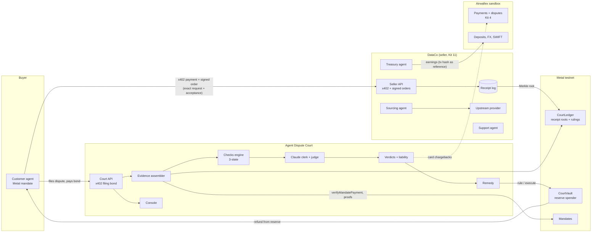

# Agent Dispute Court

**Chargebacks for agent-to-agent payments, with verdicts that execute themselves, and buying agents that use them.**

Card payments have 50 years of dispute rules: reason codes, evidence, deadlines, chargebacks. Agent payments over x402 have none. Once a stablecoin payment settles there is no issuer to call, and the x402 Foundation is still debating how disputes should work ([#3500](https://github.com/x402-foundation/x402/issues/3500), [#3678](https://github.com/x402-foundation/x402/issues/3678), [#3945](https://github.com/x402-foundation/x402/issues/3945)).

Agent Dispute Court is a working resolver for those proposals. It decides each claim from cryptographic evidence, uses Claude only where judgment is genuinely needed, and **pays refunds on chain from a seller reserve that the court itself cannot misuse**. The same court also handles ordinary card chargebacks through Airwallex.

On top of the court sits a **sourcing agent with recourse**: it buys each AI step from the best of three Claude-backed x402 providers, reroutes on price spikes and slow providers, checks every delivery against what it signed for, **files disputes by itself** when a paid delivery is broken, and routes by the court's verdicts, so providers that lose cases get used less.

> Airwallex Agentic Banking Hackathon, primary track **x402 Business Agents** (Starter Kit 11), with **Kit 12 Inference Sourcing** and the evidence-versus-cost logic of **Kit 4 Dispute Response**. Built on **Metal** testnet and the **Airwallex** sandbox.

---

## What makes it different

| | Typical dispute proposal | Agent Dispute Court |
|---|---|---|
| What did the agent agree to buy? | The route and price | **The exact request** (`GET /quote?symbol=NVDA`) *and* the delivery standard, both inside the agent's own signature |
| What was delivered? | The seller's word | A **Merkle-anchored receipt** committed on chain before any dispute |
| Who decides? | A resolver's opinion | **Code** for facts, **Claude** only for residual quality questions, **a human** when confidence is low |
| Can an unchecked claim look rejected? | Often | Never: there are three states, and `COULD_NOT_BE_CHECKED` always carries a reason |
| Does the buyer get money back? | Voluntary refund | **Enforced:** `CourtVault` captures the refund from the seller's on-chain reserve |
| Can the court steal? | n/a | No. It can only pay the named payer, capped, once, after an objection window |

Metal's docs state that a signed order covers "the route, the price, the payee and the network, not the request's parameters." We found that the agent signs the *entire* offer, so the seller can put the canonical request, its hash and the acceptance criteria into the offer. **We verified on chain that this binds the agent to the exact query and the quality bar.**

## Sourcing agent with recourse

An agent that pays other agents needs a way to get its money back. This one has it.

| Provider | Model | Price | Dispute reserve |
|---|---|---|---|
| Swift | Claude Haiku | 0.02 *USDZ | 0.5 held in `CourtVault` |
| Sterling | Claude Sonnet | 0.03 *USDZ | 0.5 held in `CourtVault` |
| Summit | Claude Opus | 0.06 *USDZ | 0.5 held in `CourtVault` |

- **Signed delivery standard.** Every offer carries an `infer-v1` acceptance (`shared/infer.ts`): JSON with the task, a `requestHash` that echoes the exact request paid for, a non-empty summary within the length limit, and 1 to 5 keywords. The provider builds to it, the agent checks against it, and the court rules on it, all with the same pure function, so they always agree.
- **Routing** (`agents/router.ts`). Each step goes to the cheapest provider that is under the price cap and answers its status probe in time. The score is `price × (1 + 2 × loss rate)`, with the loss rate taken from the court's public `GET /reputation`: a provider that loses every dispute costs three times its sticker price.
- **Recourse** (`agents/sourcing.ts`). A delivery that fails the standard is not accepted: the agent re-buys the step elsewhere, then files one dispute per provider with a complaint it writes deterministically. Code decides it (no model needed), the refund is captured from the provider's reserve, and the provider's record changes the next routing decision.
- **Limits on chain.** The agent pays under its own Metal mandate: 0.06 per payment, 3 in total, and only to the three providers and the court.

---

## Architecture



### How a dispute flows

1. **Filing.** The customer's agent `POST`s a plain-English complaint to `/disputes` and pays a 0.01 *USDZ **filing bond** over x402. The bond is refunded if any claim wins, which deters spam disputes.
2. **Intake (Claude).** The complaint becomes structured claims. Claude treats it as untrusted input and cannot invent transactions.
3. **Evidence.** For each payment the court rebuilds the sale **only from what it can verify:**
   - the signed order (`verifyMandatePayment` against the chain);
   - payer, payee and amount from the on-chain payment;
   - the delivery receipt's Merkle proof against `CourtLedger`.

   It never trusts the seller's own log for a fact.
4. **Checks (code).** Each claim gets `DIFFERENCE_CONFIRMED`, `NO_DIFFERENCE_FOUND` or `COULD_NOT_BE_CHECKED` (with a reason).
5. **Judgment (Claude, narrow).** Only for "not as described" claims the checks could not settle. The model returns `upheld`, a `confidence` and the evidence keys it cited. Below 0.8 confidence it escalates to a human. **It can never overturn a code finding.**
6. **Verdict.** REFUND, REJECT or ESCALATE, naming who is liable: the **seller**, or the **principal** whose own agent signed.
7. **Remedy.** The court publishes the ruling to `CourtVault`. After the seller's objection window, anyone can execute it and the refund is captured from the seller's reserve straight to the buyer.

---

## Reason codes

| Code | Claim | Decided by | Card analogue |
|---|---|---|---|
| `A10` | "My agent never ordered this" | Mandate binding + signature over the exact request | Visa 10.4 |
| `A12` | "Charged twice" | Same signed request hash settled twice, from chain history | Visa 12.6.1 |
| `A13.1` | "Paid, got nothing" | No anchored receipt, or an error response | Visa 13.1 |
| `A13.3` | "Not as described" | The **signed acceptance criteria** (freshness, accuracy, symbol) re-run on the anchored body; Claude only for the remainder | Visa 13.3 |
| `A14` | "Price or payee was off" | The signed offer against the seller's price list | n/a |

---

## Mapping to the x402 dispute proposals

| Proposal | What it asks for | Where it lives here |
|---|---|---|
| [#3500](https://github.com/x402-foundation/x402/issues/3500): dispute evidence for agent payments | An **evidence triple**: authorization scope, the action, and a structured delta that a resolver can check mechanically | **Scope** = the Metal mandate, bound on chain. **Action** = the settled payment plus the agent's signed order. **Delta** = computed by `court/checks.ts` from those artifacts, never asserted by a party. The aggregate cases from the thread (duplicates, spend across payments) are rebuilt from the mandate's full on-chain history. |
| [#3678](https://github.com/x402-foundation/x402/issues/3678): delivery conformance | Acceptance criteria **in the offer**; the receipt carries the hash of the delivered body; a resolver re-runs a named verifier | The offer's `extra.acceptance = {verifier: "quote-v1", maxStalenessMs, maxDeviationBps}` is **signed by the buyer's agent**. Each receipt stores `responseHash`, anchored in a Merkle root on `CourtLedger`. `A13.3` re-runs the verifier on the anchored body. |
| [#3945](https://github.com/x402-foundation/x402/issues/3945): three states, computed delta | `DIFFERENCE_CONFIRMED` / `NO_DIFFERENCE_FOUND` / `COULD_NOT_BE_CHECKED`, so an unchecked dispute is never silently dismissed | The exact three states, each with a reason. An unchecked claim is only ever escalated or sent to the judge, **never rejected**. |
| The "liability but no recovery" gap raised in #3500 | Remedies on a push rail | `CourtVault` + MIP20 holds give **enforced recovery**: the seller's reserve is held on chain and only the court's published, capped, objection-windowed rulings can release it. |

---

## Live evidence

Everything below happened on **Metal testnet (chain 63825)** or the **Airwallex sandbox**. Explorer: `https://testnet.metalntwx.com/tx/<hash>`.

### Contracts
| Contract | Address |
|---|---|
| `CourtLedger` (receipt roots + rulings) | [`0x2528db9267bd6bc9950ab74ad83d748b64e18042`](https://testnet.metalntwx.com/address/0x2528db9267bd6bc9950ab74ad83d748b64e18042) |
| `CourtVault` (reserve spender) | [`0xe0e90b1bc4792aa26cb83c7f2e82c3a19b7e46d8`](https://testnet.metalntwx.com/address/0xe0e90b1bc4792aa26cb83c7f2e82c3a19b7e46d8) |

### Sourcing agent: six documents, one lawsuit (`scripts/sourcing-demo.ts`)

| Step | What happened | Tx |
|---|---|---|
| Docs 1–2 | Cheapest provider wins: Swift, 0.02 each | [`0x8936dd…34f7`](https://testnet.metalntwx.com/tx/0x8936dd8aef40b225fc5194e07b0c7f285de19e949d335a2e70cf66ad24eb34f7), [`0x18d4ec…4bd1`](https://testnet.metalntwx.com/tx/0x18d4ecd2c4e9bcdefb258eaa4cccfb1ca975217964fd339eda454c4fc3084bd1) |
| Doc 3 | Swift jumps to 0.07, over the cap; rerouted to Sterling | [`0x6b8e08…e802`](https://testnet.metalntwx.com/tx/0x6b8e088697266b170a3f71f88691502e63f1d55f73bb04939df0e5d8c7f2e802) |
| Doc 4 | Sterling paid, delivers a truncated body (`body_unparseable`) | [`0x6bf4a2…9b33`](https://testnet.metalntwx.com/tx/0x6bf4a2d2f8448bb1550e0fe8ef0a6915cfc8d0c10c9a859ec061f46923389b33) |
| Doc 4 | Re-bought from Summit, accepted | [`0xf16102…4f99`](https://testnet.metalntwx.com/tx/0xf16102e4cb0207bfffa31f749aacebe1479ca51985924b4d43b3acdf9f4c4f99) |
| Doc 5 | Summit answers in 5 s, excluded as slow; Sterling delivers | [`0xcc1bbd…8f73`](https://testnet.metalntwx.com/tx/0xcc1bbda315f1f3a7cc7400a874b87a7e1e9f82dbb0a7d6499500c1c3e2458f73) |
| Anchor | Sterling's 3 receipts committed as one Merkle root | [`0x2149a2…1943`](https://testnet.metalntwx.com/tx/0x2149a29bd795a6a956e9b8c9b1f411b542cdbcce0a8128479f23128b8df61943) |
| Dispute | The agent files against Sterling and pays the filing bond | [`0x901f87…96f3`](https://testnet.metalntwx.com/tx/0x901f8771d47d4c1299c90e9ad5559c3553ae736e795aa13bbcec3cc17b6896f3) |
| Ruling | A13.3, decided by code: REFUND 0.03, published | [`0x264d05…f964`](https://testnet.metalntwx.com/tx/0x264d05bf267ce55e7a91bba03b3362c4fa5651563870435f0e9680681fa8f964) |
| Doc 6 | Sterling now scores 0.03 × 3 = 0.09, worse than Summit; Swift (back to 0.02) wins | [`0x4fb4a9…ad63`](https://testnet.metalntwx.com/tx/0x4fb4a94a8d3e4edb4b673a3b34d5314deab456f35ac013c8feda2bdf9c52ad63) |

After the objection window, the 0.03 refund was captured from Sterling's reserve and the filing bond was returned. Six of six documents completed for 0.21 *USDZ spent and 0.03 recovered.

### Court: one full case (`scripts/demo.ts`)
The customer agent bought six quotes. DataCo served a **stale** TSLA quote and an **MSFT price 3% off**, and charged AAPL **twice**. Then the customer filed:

> *"My agent never asked for NVDA, it wanted AMD. I was charged twice for AAPL. The TSLA quote was stale and the MSFT price was wrong. The GOOG price also looked wrong, but I can't tell you by how much."*

| Claim | Finding | Verdict | Decided by | Purchase | Ruling | Refund |
|---|---|---|---|---|---|---|
| NVDA "never ordered" (A10) | signature names `?symbol=NVDA` | REJECT, the customer is liable | code | [`0xa52cc0…5d5c`](https://testnet.metalntwx.com/tx/0xa52cc0c6eb0b89234432eb05c0253589967a43ebec8b08fea583b09969ea5d5c) | n/a | n/a |
| AAPL first charge (A12) | not a duplicate | REJECT | code | [`0xf6bd28…786c`](https://testnet.metalntwx.com/tx/0xf6bd28967c5c1da733ecfed8c05d6a0c97c1cc577920ef3c3c643859c32d786c) | n/a | n/a |
| AAPL second charge (A12) | duplicate of the first | REFUND | code | [`0xbb8f3e…5531`](https://testnet.metalntwx.com/tx/0xbb8f3e5134b9aa88c292ff4099b4de253d6da37c15ae503d1c19d0df9c055531) | [`0xdbc74b…46a5`](https://testnet.metalntwx.com/tx/0xdbc74b31cd6a20db19411db50a4cabbcd321801a45d670507baa0fe3ba7b46a5) | [`0xdaf1eb…0b9d`](https://testnet.metalntwx.com/tx/0xdaf1eb85bab476b5ad1077cdfbb78be849302fbf651b91e47c8818cd354d0b9d) |
| TSLA stale (A13.3) | breaks the signed 60 s freshness | REFUND | code | [`0xa34242…a062`](https://testnet.metalntwx.com/tx/0xa34242aea91183f461cf40a109734818abf69f4e7e9753dac65d0e2602eba062) | [`0x8c7140…d0ac`](https://testnet.metalntwx.com/tx/0x8c7140b54dfb6ff33ffdaf9f02b2a2e15df66a6dda4a5f3e6f65356c1a3ed0ac) | [`0xfd0895…b215`](https://testnet.metalntwx.com/tx/0xfd08953d89d1d49e477cc4d3d90305e60214e200e848437dfb4a195ab317b215) |
| MSFT wrong (A13.3) | about 300 bps off, above the signed 50 bps limit | REFUND | code | [`0x05ba53…c2e2`](https://testnet.metalntwx.com/tx/0x05ba5309dd60e993506c3ebd94309a17e5340366f008da3062b15e0a4a35c2e2) | [`0xe6b37b…ad20`](https://testnet.metalntwx.com/tx/0xe6b37b768632326a59492120bc3a468b6a1af420b2bb7c53f83b1dee911aad20) | [`0xfc3a3a…f723`](https://testnet.metalntwx.com/tx/0xfc3a3ab8019ce082a3fdf130f59f3b579e84c158133ca0cd254378044a90f723) |
| GOOG "looked wrong" (A13.3) | could not be checked (no GOOG reference feed); Claude escalated | REFUND, approved by a human bound to 0.05 | human | [`0xabe615…73ce`](https://testnet.metalntwx.com/tx/0xabe615bef30e1f513deade7fb4b44702dad0d4e4297bc9590e98613163c073ce) | [`0xfc425a…5d71`](https://testnet.metalntwx.com/tx/0xfc425a6a28669fbb0c2f56b5e59812e77ad79aac9ac265e800fcae4936bf5d71) | [`0x7324ea…492d`](https://testnet.metalntwx.com/tx/0x7324eaf52f00f2f9dad142471b8ca5941a7e6b44fdb7463345eb5c014533492d) |

| Step | Transaction |
|---|---|
| Six receipts anchored (`CourtLedger` batch 3) | [`0xdc4c28…80d8`](https://testnet.metalntwx.com/tx/0xdc4c2851274a221de5e5008b9ffbadcb62ccefef8f2e5835b86f07d14fe880d8) |
| Dispute filed, filing bond paid over x402 | [`0xa761bf…30d3`](https://testnet.metalntwx.com/tx/0xa761bf21dd1491dcb6a75ceaa0883d99262292204402b0244208a1c00a9330d3) |
| Filing bond refunded (the customer won some claims) | [`0xff2236…18f5`](https://testnet.metalntwx.com/tx/0xff2236d115f17fdbb940bc9cde4e9c5f199d7561ea97d579946e86ecf6ed18f5) |
| Customer mandate lists the court as a payee (opt-in) | [`0x0147aa…ace5`](https://testnet.metalntwx.com/tx/0x0147aaaac8a9b0ea193e1ba9d1f70ae551b7a71172f3cd598529100aa4a3ace5) |

All four refunds were captured from DataCo's reserve in `CourtVault` after the seller's objection window, and the customer's balance shows them.

### Kit 11 business agents (price jump)
| Step | Transaction / result |
|---|---|
| Sourcing agent buys upstream at 0.02 | [`0x582e9c…`](https://testnet.metalntwx.com/tx/0x582e9c405c3d64393f46a648518de1005f7f592bba484952eac6f5632996f59b), [`0xac8c8f…`](https://testnet.metalntwx.com/tx/0xac8c8f1606b923e18e699befd6ce2b867a797b5db9ea1e93490b9c7cbbf9a545) |
| Upstream rises to 0.04, so the next purchase is refused on chain | `mandate_cap_exceeded`, nothing paid |
| Re-plan from on-chain spend, human approval, mandate replaced | cap 0.03 → 0.04, total held at 20.00 *USDZ |
| Treasury moves earnings to settlement | [`0xab4ab5…651e`](https://testnet.metalntwx.com/tx/0xab4ab554ee9036ade2157e6194e778ab55d82edd5d9ba560e16e4a032da6651e) |
| Earnings credited in Airwallex (deposit reference = that tx hash) | sandbox deposit |
| EUR 50 licence fee paid by SWIFT | sandbox transfer `a51d61b9-fb59-4f94-b17e-65c9eddd6bb0` |

### Card rail (Airwallex, Kit 4)
| Case | Decision | Result |
|---|---|---|
| USD fraud claim (10.4), device match, 3 prior orders, signed delivery | **CHALLENGE** (p = 0.85) | Evidence PDF uploaded, challenged; the bank escalates to CHARGEBACK and the case is back in `REQUIRES_RESPONSE` |
| Small not-received claim (13.1), dispute fee exceeds expected recovery | **ACCEPT** | `ACCEPTED` |
| Credit not processed (13.6), customer wrote to support twice with no reply | **ESCALATE** | To a human, no API call |

A card dispute is challenged only when `p × amount > dispute fee`.

---

## Design principles

- **Code owns facts.** Signatures, amounts, duplicates, deadlines, caps and idempotency are decided in code. The model weighs only data quality, and its output is schema-validated.
- **No unchecked claim looks rejected.** There are three states, and the unchecked state carries its reason.
- **Approvals are bound to the amount shown.** A human approval must restate the exact proposed refund, or it is refused (409).
- **Money moves at most once.**
  - Rulings: one per payment, enforced by the contract.
  - Mandate payouts: keyed by `--payment-id`.
  - The filing-fee refund: guarded by a per-case lock.
  - Treasury settlement: idempotent by tx hash.
- **A crash is never a refusal.** A tool failure is reported as an error and stops the run; only a mandate's own refusal line counts as `refused`.
- **Secrets stay out.** Keys are loaded from file paths at runtime, and error messages are sanitized. The paid RPC URL embeds a credential, so public pages never show raw errors.

---

## Repository

| Path | What |
|---|---|
| `seller/` | DataCo API: per-request signed offers, receipts, Merkle anchoring |
| `providers/` | Claude-backed x402 inference providers (Swift, Sterling, Summit) with operator price, latency and fault controls |
| `court/` | Evidence, checks, Claude clerk and judge, verdicts, case runner, `CourtVault` remedy, HTTP API, store |
| `card/` | Airwallex client, Kit 4 decision logic, evidence PDF builder |
| `treasury/` | Deposits by tx-hash reference, FX, beneficiaries, SWIFT licence fee |
| `agents/` | Sourcing router and recourse loop, upstream provider, mandate planner, `metal-agent` CLI wrapper |
| `contracts/` | `CourtLedger.sol`, `CourtVault.sol` (+ `build/`) |
| `console/` | Operator console (plain HTML/CSS/JS, strict CSP) |
| `shared/` | Types, `infer-v1` delivery standard, Merkle tree (MetalAssertions-compatible hashing) |
| `scripts/` | `sourcing-demo.ts`, `demo.ts`, `card-demo.ts`, `kit11-demo.ts`, `setup-beneficiary.ts`, `compile.ts`, live smoke tests |
| `tasks/` | The specs each module was built from |

The suite has 251 tests, run with `npm test`; none of them touch the network.

---

## Setup

**Requirements:** Node 26 or later (TypeScript runs natively, with no build step), a Metal testnet RPC endpoint, an Airwallex sandbox account in a payments-supported country, and an Anthropic API key.

```bash
npm install
npm test
npm run compile
```

Keys and credentials are **never** stored in this repo. Point the services at files and environment variables you keep elsewhere.

**1. Seller (DataCo)**
```bash
SELLER_PAY_TO=0x... METAL_RPC_URL=... PORT=4031 node seller/server.ts
```

**2. Court**
```bash
METAL_RPC_URL=... COURT_KEY_FILE=/path/court.key.json \
COURT_VAULT=0xe0e90b1bc4792aa26cb83c7f2e82c3a19b7e46d8 \
COURT_LEDGER=0x2528db9267bd6bc9950ab74ad83d748b64e18042 COURT_LEDGER_FROM_BLOCK=8345602 \
COURT_SELLERS=sellers.json \
OPERATOR_TOKEN=... ANTHROPIC_API_KEY=... COURT_PORT=4022 \
node court/main.ts
```
`sellers.json` lists every seller the court serves, each with its receipt log and price list:
```json
[{"name":"DataCo","address":"0x...","receipts":"data/receipts.jsonl","priceList":{"GET /quote":"0.05"}},
 {"name":"Swift","address":"0x...","receipts":"data/receipts-swift.jsonl","priceList":{"GET /infer":"0.02"}}]
```
With a single seller you can set `SELLER=0x... SELLER_RECEIPTS=...` instead. Open the console at `http://localhost:4022/console/`.

**3. File a dispute as the customer's agent** (its mandate must list the court as a payee):
```bash
npx metal-agent pay http://127.0.0.1:4022/disputes --mandate customer.json --network testnet \
  --method POST --body '{"payer":"0x...","txs":["0x..."],"complaint":"My agent never asked for NVDA."}'
```

**4. Sourcing agent with recourse.** Start the three providers (launch lines are in the header of `providers/server.ts`), give the buying agent a mandate that lists them and the court, then:
```bash
PROVIDER_URLS=http://127.0.0.1:4061,http://127.0.0.1:4062,http://127.0.0.1:4063 \
PROVIDER_KEY_FILES=/path/swift.key.json,/path/sterling.key.json,/path/summit.key.json \
CUSTOMER_CRED=/path/sourcing-buyer.json STEP_MAX_PRICE=0.06 node scripts/sourcing-demo.ts
```
The full environment variable list is in the script header.

**5. Card rail (Kit 4)**
```bash
AWX_CLIENT_ID=... AWX_API_KEY=... node scripts/card-demo.ts
```

**6. Kit 11 business agents and treasury.** Start the upstream provider:
```bash
UPSTREAM_PAY_TO=0x... OPERATOR_TOKEN=... PORT=4051 node agents/upstream.ts
```
Then run the scene. The full environment variable list is in the script header.
```bash
APPROVE=yes node scripts/kit11-demo.ts
```

### Metal gotchas we hit (so you don't)
- Contract writes need explicit `gas` and `maxFeePerGas: 1n`, because gas estimation checks a native balance that Metal doesn't have.
- `eth_getLogs` is limited to 100,000 blocks per query, so scan in chunks from the deployment block.
- Mandates pay whole cents only, and a replacement carries the old mandate's spend into the new budget.

### Airwallex gotchas
- Payment acceptance depends on the account's registration country, so use a supported one (we use US).
- The live EUR SWIFT fee was **EUR 13.47**, not the documented 12.85, so read `fee_amount` from the transfer response.
- Evidence uploads go to `files.sandbox.airwallex.com` and must be PDF or JPG.

---

## Built with

Metal (`@metalntwx/metal-pay`, `metal-agent`, mandates, signed orders, MIP20 holds), x402 (`@x402/core`, `@x402/express`), Airwallex (payment disputes, files, deposits, FX, beneficiaries, transfers), Claude (structured outputs), viem, solc, Express.
