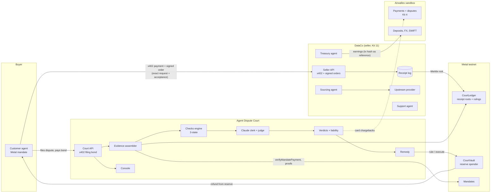

# Agent Dispute Court

**Chargebacks for agent-to-agent payments, with verdicts that execute themselves.**

Card payments have 50 years of dispute rules: reason codes, evidence, deadlines, chargebacks. Agent payments over x402 have none. Once a stablecoin payment settles there is no issuer to call, and the x402 Foundation is still debating how disputes should work ([#3500](https://github.com/x402-foundation/x402/issues/3500), [#3678](https://github.com/x402-foundation/x402/issues/3678), [#3945](https://github.com/x402-foundation/x402/issues/3945)).

Agent Dispute Court is a working resolver for those proposals. It decides each claim from cryptographic evidence, uses Claude only where judgment is genuinely needed, and **pays refunds on chain from a seller reserve that the court itself cannot misuse**. The same court also handles ordinary card chargebacks through Airwallex.

> Airwallex Agentic Banking Hackathon, primary track **x402 Business Agents** (Starter Kit 11), with the evidence-versus-cost logic of **Kit 4 Dispute Response**. Built on **Metal** testnet and the **Airwallex** sandbox.

---

## What makes it different

| | Typical dispute proposal | Agent Dispute Court |
|---|---|---|
| What did the agent agree to buy? | The route and price | **The exact request** (`GET /quote?symbol=NVDA`) *and* the delivery standard, both inside the agent's own signature |
| What was delivered? | The seller's word | A **Merkle-anchored receipt** committed on chain before any dispute |
| Who decides? | A resolver's opinion | **Code** for facts, **Claude** only for residual quality questions, **a human** when confidence is low |
| Can an unchecked claim look rejected? | Often | Never: there are three states, and `COULD_NOT_BE_CHECKED` always carries a reason |
| Does the buyer get money back? | Voluntary refund | **Enforced:** `CourtVault` captures the refund from the seller's on-chain reserve |
| Can the court steal? | n/a | No. It can only pay the named payer, capped, once, after an objection window |

Metal's docs state that a signed order covers "the route, the price, the payee and the network, not the request's parameters." We found that the agent signs the *entire* offer, so the seller can put the canonical request, its hash and the acceptance criteria into the offer. **We verified on chain that this binds the agent to the exact query and the quality bar.**

---

## Architecture



### How a dispute flows

1. **Filing.** The customer's agent `POST`s a plain-English complaint to `/disputes` and pays a 0.01 *USDZ **filing bond** over x402. The bond is refunded if any claim wins, which deters spam disputes.
2. **Intake (Claude).** The complaint becomes structured claims. Claude treats it as untrusted input and cannot invent transactions.
3. **Evidence.** For each payment the court rebuilds the sale **only from what it can verify:**
   - the signed order (`verifyMandatePayment` against the chain);
   - payer, payee and amount from the on-chain payment;
   - the delivery receipt's Merkle proof against `CourtLedger`.

   It never trusts the seller's own log for a fact.
4. **Checks (code).** Each claim gets `DIFFERENCE_CONFIRMED`, `NO_DIFFERENCE_FOUND` or `COULD_NOT_BE_CHECKED` (with a reason).
5. **Judgment (Claude, narrow).** Only for "not as described" claims the checks could not settle. The model returns `upheld`, a `confidence` and the evidence keys it cited. Below 0.8 confidence it escalates to a human. **It can never overturn a code finding.**
6. **Verdict.** REFUND, REJECT or ESCALATE, naming who is liable: the **seller**, or the **principal** whose own agent signed.
7. **Remedy.** The court publishes the ruling to `CourtVault`. After the seller's objection window, anyone can execute it and the refund is captured from the seller's reserve straight to the buyer.

---

## Reason codes

| Code | Claim | Decided by | Card analogue |
|---|---|---|---|
| `A10` | "My agent never ordered this" | Mandate binding + signature over the exact request | Visa 10.4 |
| `A12` | "Charged twice" | Same signed request hash settled twice, from chain history | Visa 12.6.1 |
| `A13.1` | "Paid, got nothing" | No anchored receipt, or an error response | Visa 13.1 |
| `A13.3` | "Not as described" | The **signed acceptance criteria** (freshness, accuracy, symbol) re-run on the anchored body; Claude only for the remainder | Visa 13.3 |
| `A14` | "Price or payee was off" | The signed offer against the seller's price list | n/a |

---

## Mapping to the x402 dispute proposals

| Proposal | What it asks for | Where it lives here |
|---|---|---|
| [#3500](https://github.com/x402-foundation/x402/issues/3500): dispute evidence for agent payments | An **evidence triple**: authorization scope, the action, and a structured delta that a resolver can check mechanically | **Scope** = the Metal mandate, bound on chain. **Action** = the settled payment plus the agent's signed order. **Delta** = computed by `court/checks.ts` from those artifacts, never asserted by a party. The aggregate cases from the thread (duplicates, spend across payments) are rebuilt from the mandate's full on-chain history. |
| [#3678](https://github.com/x402-foundation/x402/issues/3678): delivery conformance | Acceptance criteria **in the offer**; the receipt carries the hash of the delivered body; a resolver re-runs a named verifier | The offer's `extra.acceptance = {verifier: "quote-v1", maxStalenessMs, maxDeviationBps}` is **signed by the buyer's agent**. Each receipt stores `responseHash`, anchored in a Merkle root on `CourtLedger`. `A13.3` re-runs the verifier on the anchored body. |
| [#3945](https://github.com/x402-foundation/x402/issues/3945): three states, computed delta | `DIFFERENCE_CONFIRMED` / `NO_DIFFERENCE_FOUND` / `COULD_NOT_BE_CHECKED`, so an unchecked dispute is never silently dismissed | The exact three states, each with a reason. An unchecked claim is only ever escalated or sent to the judge, **never rejected**. |
| The "liability but no recovery" gap raised in #3500 | Remedies on a push rail | `CourtVault` + MIP20 holds give **enforced recovery**: the seller's reserve is held on chain and only the court's published, capped, objection-windowed rulings can release it. |

---

## Live evidence

Everything below happened on **Metal testnet (chain 63825)** or the **Airwallex sandbox**. Explorer: `https://testnet.metalntwx.com/tx/<hash>`.

### Contracts
| Contract | Address |
|---|---|
| `CourtLedger` (receipt roots + rulings) | [`0x2528db9267bd6bc9950ab74ad83d748b64e18042`](https://testnet.metalntwx.com/address/0x2528db9267bd6bc9950ab74ad83d748b64e18042) |
| `CourtVault` (reserve spender) | [`0xe0e90b1bc4792aa26cb83c7f2e82c3a19b7e46d8`](https://testnet.metalntwx.com/address/0xe0e90b1bc4792aa26cb83c7f2e82c3a19b7e46d8) |

### Court
| Step | Transaction |
|---|---|
| Customer agent pays for `GET /quote?symbol=MSFT` (signed for the exact request and acceptance criteria) | [`0x682b91…2ae2`](https://testnet.metalntwx.com/tx/0x682b910e6ebbc09becc57d7a75eb70122d0a205d81b8db27bb85aec531892ae2) |
| Receipts anchored (batch 1, 3 receipts, proofs verified on chain) | [`0xc0acba…ea36`](https://testnet.metalntwx.com/tx/0xc0acba65f4ec3197274a725943e2a879d889df07cf8256b867061a48e99bea36) |
| Customer mandate updated to allow paying the court (opt-in) | [`0x23def5…f435`](https://testnet.metalntwx.com/tx/0x23def534dbc83bafb6b790e78e90f2ead4fad795a477ea59ed34d53b97a4f435) |
| Dispute filed, filing bond paid over x402 | [`0xa3f1f6…3efc`](https://testnet.metalntwx.com/tx/0xa3f1f6f7c356d67dbb249ceae129be5547b95852546650a00eaa521080e53efc) |
| Ruling published to `CourtVault` | [`0x1ade1c…96a3`](https://testnet.metalntwx.com/tx/0x1ade1cc13f6a215a0f4d2b0354cd1b128f441170ce1b7e53f28947ae594596a3) |
| Refund executed from the seller's reserve after the objection window | [`0xff28f0…7ae6`](https://testnet.metalntwx.com/tx/0xff28f0c86dc29c689af210a6e15ca8ef29b06f290dfff69624125d89a39a7ae6) |

On the live case, the claim *"my agent never asked for NVDA, it wanted AMD"* was **rejected by code**: the agent's signature names `?symbol=NVDA`. The claim *"the TSLA quote looked wrong"* was **escalated** by Claude, at confidence 0.2, because the evidence was too thin to decide.

### Kit 11 business agents (price jump)
| Step | Transaction / result |
|---|---|
| Sourcing agent buys upstream at 0.02 | [`0x582e9c…`](https://testnet.metalntwx.com/tx/0x582e9c405c3d64393f46a648518de1005f7f592bba484952eac6f5632996f59b), [`0xac8c8f…`](https://testnet.metalntwx.com/tx/0xac8c8f1606b923e18e699befd6ce2b867a797b5db9ea1e93490b9c7cbbf9a545) |
| Upstream rises to 0.04, so the next purchase is refused on chain | `mandate_cap_exceeded`, nothing paid |
| Re-plan from on-chain spend, human approval, mandate replaced | cap 0.03 → 0.04, total held at 20.00 *USDZ |
| Treasury moves earnings to settlement | [`0xab4ab5…651e`](https://testnet.metalntwx.com/tx/0xab4ab554ee9036ade2157e6194e778ab55d82edd5d9ba560e16e4a032da6651e) |
| Earnings credited in Airwallex (deposit reference = that tx hash) | sandbox deposit |
| EUR 50 licence fee paid by SWIFT | sandbox transfer `a51d61b9-fb59-4f94-b17e-65c9eddd6bb0` |

### Card rail (Airwallex, Kit 4)
| Case | Decision | Result |
|---|---|---|
| USD fraud claim (10.4), device match, 3 prior orders, signed delivery | **CHALLENGE** (p = 0.85) | Evidence PDF uploaded, challenged; the bank escalates to CHARGEBACK and the case is back in `REQUIRES_RESPONSE` |
| Small not-received claim (13.1), dispute fee exceeds expected recovery | **ACCEPT** | `ACCEPTED` |
| Credit not processed (13.6), customer wrote to support twice with no reply | **ESCALATE** | To a human, no API call |

A card dispute is challenged only when `p × amount > dispute fee`.

---

## Design principles

- **Code owns facts.** Signatures, amounts, duplicates, deadlines, caps and idempotency are decided in code. The model weighs only data quality, and its output is schema-validated.
- **No unchecked claim looks rejected.** There are three states, and the unchecked state carries its reason.
- **Approvals are bound to the amount shown.** A human approval must restate the exact proposed refund, or it is refused (409).
- **Money moves at most once.**
  - Rulings: one per payment, enforced by the contract.
  - Mandate payouts: keyed by `--payment-id`.
  - The filing-fee refund: guarded by a per-case lock.
  - Treasury settlement: idempotent by tx hash.
- **A crash is never a refusal.** A tool failure is reported as an error and stops the run; only a mandate's own refusal line counts as `refused`.
- **Secrets stay out.** Keys are loaded from file paths at runtime, and error messages are sanitized. The paid RPC URL embeds a credential, so public pages never show raw errors.

---

## Repository

| Path | What |
|---|---|
| `seller/` | DataCo API: per-request signed offers, receipts, Merkle anchoring |
| `court/` | Evidence, checks, Claude clerk and judge, verdicts, case runner, `CourtVault` remedy, HTTP API, store |
| `card/` | Airwallex client, Kit 4 decision logic, evidence PDF builder |
| `treasury/` | Deposits by tx-hash reference, FX, beneficiaries, SWIFT licence fee |
| `agents/` | Upstream provider, mandate planner, `metal-agent` CLI wrapper |
| `contracts/` | `CourtLedger.sol`, `CourtVault.sol` (+ `build/`) |
| `console/` | Operator console (plain HTML/CSS/JS, strict CSP) |
| `shared/` | Types, Merkle tree (MetalAssertions-compatible hashing) |
| `scripts/` | `card-demo.ts`, `kit11-demo.ts`, `setup-beneficiary.ts`, `compile.ts`, live smoke tests |
| `tasks/` | The specs each module was built from |

The suite has 181 tests, run with `npm test`; none of them touch the network.

---

## Setup

**Requirements:** Node 26 or later (TypeScript runs natively, with no build step), a Metal testnet RPC endpoint, an Airwallex sandbox account in a payments-supported country, and an Anthropic API key.

```bash
npm install
npm test
npm run compile
```

Keys and credentials are **never** stored in this repo. Point the services at files and environment variables you keep elsewhere.

**1. Seller (DataCo)**
```bash
SELLER_PAY_TO=0x... METAL_RPC_URL=... PORT=4031 node seller/server.ts
```

**2. Court**
```bash
METAL_RPC_URL=... COURT_KEY_FILE=/path/court.key.json \
COURT_VAULT=0xe0e90b1bc4792aa26cb83c7f2e82c3a19b7e46d8 \
COURT_LEDGER=0x2528db9267bd6bc9950ab74ad83d748b64e18042 COURT_LEDGER_FROM_BLOCK=8345602 \
SELLER=0x... SELLER_RECEIPTS=data/receipts.jsonl \
OPERATOR_TOKEN=... ANTHROPIC_API_KEY=... COURT_PORT=4022 \
node court/main.ts
```
Open the console at `http://localhost:4022/console/`.

**3. File a dispute as the customer's agent** (its mandate must list the court as a payee):
```bash
npx metal-agent pay http://127.0.0.1:4022/disputes --mandate customer.json --network testnet \
  --method POST --body '{"payer":"0x...","txs":["0x..."],"complaint":"My agent never asked for NVDA."}'
```

**4. Card rail (Kit 4)**
```bash
AWX_CLIENT_ID=... AWX_API_KEY=... node scripts/card-demo.ts
```

**5. Kit 11 business agents and treasury.** Start the upstream provider:
```bash
UPSTREAM_PAY_TO=0x... OPERATOR_TOKEN=... PORT=4051 node agents/upstream.ts
```
Then run the scene. The full environment variable list is in the script header.
```bash
APPROVE=yes node scripts/kit11-demo.ts
```

### Metal gotchas we hit (so you don't)
- Contract writes need explicit `gas` and `maxFeePerGas: 1n`, because gas estimation checks a native balance that Metal doesn't have.
- `eth_getLogs` is limited to 100,000 blocks per query, so scan in chunks from the deployment block.
- Mandates pay whole cents only, and a replacement carries the old mandate's spend into the new budget.

### Airwallex gotchas
- Payment acceptance depends on the account's registration country, so use a supported one (we use US).
- The live EUR SWIFT fee was **EUR 13.47**, not the documented 12.85, so read `fee_amount` from the transfer response.
- Evidence uploads go to `files.sandbox.airwallex.com` and must be PDF or JPG.

---

## Built with

Metal (`@metalntwx/metal-pay`, `metal-agent`, mandates, signed orders, MIP20 holds), x402 (`@x402/core`, `@x402/express`), Airwallex (payment disputes, files, deposits, FX, beneficiaries, transfers), Claude (structured outputs), viem, solc, Express.
